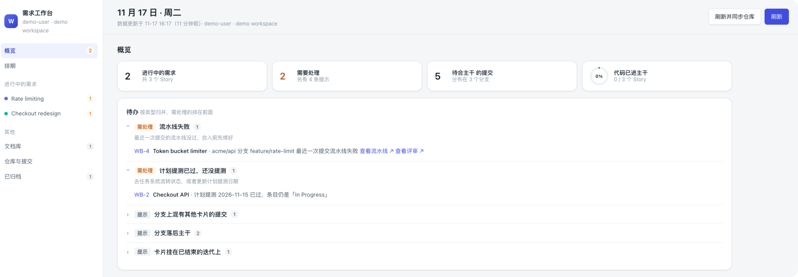
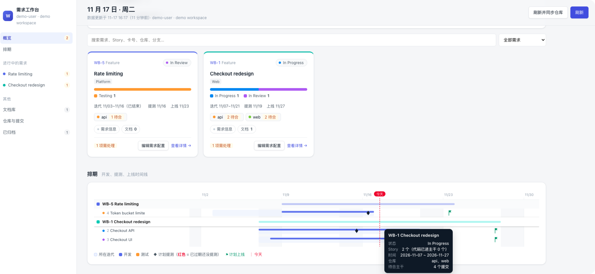
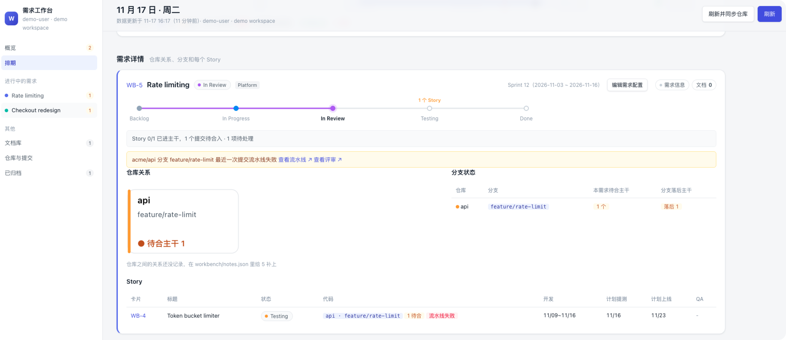
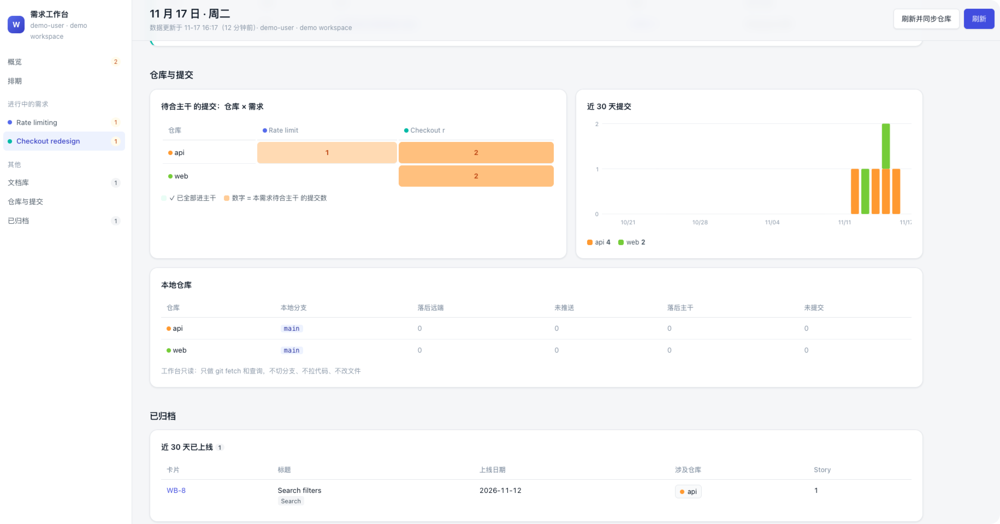

# workbench

English | [简体中文](README.zh-CN.md)

A local dashboard for the work items assigned to you and the code behind them. For each requirement it shows
which repositories and branches are involved, whether the commits already reached the default branch, review and
pipeline state, the schedule, and a to-do list of things that need attention.

- Python 3.9+, standard library only. The UI is plain HTML, JavaScript and SVG, with no build step.
- Read-only on your repositories: it runs `git fetch` and queries, never switches branches, pulls or edits files.
- The task tracker is a plugin. GitHub (issues, sub-issues, Projects v2, pull requests) is built in. Anything else
  is a provider you write, see [Providers](#providers).
- The UI is currently in Chinese. An English language pack is planned.

## Try it

```bash
python3 -m workbench serve --demo      # fictional items in throw-away git repos, no account needed
```

Open http://127.0.0.1:8765/.









## Use it with GitHub

```bash
python3 -m workbench init --provider github --workspace ~/code    # writes config.json, runs the checks
python3 -m workbench doctor                                        # re-run the checks any time
./restart.sh                                                       # start in the background on 127.0.0.1:8765
```

Authentication: set `GITHUB_TOKEN` (or `GH_TOKEN`), or log in with the `gh` CLI (`gh auth login`). To read stages,
dates and iterations from a Projects v2 board the token needs the `read:project` scope
(`gh auth refresh -s read:project`). Without it, stages fall back to labels named `status:<stage>`, then open/closed.

What counts as what:

- An item is an open issue assigned to you in one of your local repositories. Its parent (a sub-issue's parent issue)
  is the requirement.
- Pull requests that reference the issue provide commits, reviews and check results.
- `workspace` is the directory that holds your clones. It is searched recursively (up to 3 levels), the GitHub
  remotes of every clone are read, and only issues in those repositories are collected. A project you no longer want
  to track drops out when you delete its clone or move it out of the workspace. Clones elsewhere can be listed in
  `repo_paths` in `config.json`. Set `github.workspace_only` to `false` to collect every issue assigned to you
  instead, and use `github.search` (for example `org:my-org -repo:my-org/finished`) to narrow that down.
- Every clone found this way is listed under repositories and commits, with its local state and the remote branches
  that are not merged into the default branch, whether or not an issue refers to it. Requirements still come from
  issues.

See `examples/config.github.json` for every option.

## Where things live

Everything specific to you lives in the data directory, never next to the code: `$WORKBENCH_HOME`, else
`$XDG_CONFIG_HOME/workbench`, else `~/.config/workbench`.

- `config.json`: provider, workspace, host and port, provider options.
- `notes.json`: what you maintain by hand per requirement: repo relations (`nodes`, `edges`, `note`), a summary
  (`info`), document links (`docs`), `track` and the archive. Format in `examples/notes.example.json`. Editing it in
  the UI or by hand, then pressing refresh, is enough.
- `data.json`, `logs/`, `app.pid`: runtime files.

The server listens on `127.0.0.1` and has no login. If you bind it to another address, anyone who can reach the port
sees your items. Cross-origin POST requests from browsers are refused.

## Commands

```
python3 -m workbench serve [--demo] [--host H] [--port P]
python3 -m workbench collect [--no-fetch] [--demo]    # collect once, write data.json
python3 -m workbench init --provider NAME --workspace DIR [--set key.sub=value ...]
python3 -m workbench doctor
./restart.sh [port] | ./restart.sh stop
```

`pip install .` installs a `workbench` command with the same subcommands.

## Providers

A provider turns a tracker into plain dicts, so the core never sees tracker-specific fields. The contract is
documented in `workbench/providers/base.py`: `workflow()`, `whoami()`, `list_items()`, `get_parent()`,
`dev_info()`, plus optional URLs, id references in commit messages, iteration parsing and `doctor()`.

To add one, create a module with a class named `Provider` and point the config at it:

```json
{"provider": "mytracker", "provider_module": "my_pkg", "plugin_paths": ["~/code/my-plugin"]}
```

Plugins can also register an entry point in the group `workbench.providers`. `workbench/providers/demo.py` is the
smallest complete example and `tests/test_github.py` shows how to test a provider with a fake client.

## Development

```bash
python3 -m unittest discover -s tests -t .
node tests/ui_smoke.js <path to a data.json>      # renders the UI scripts against a stub DOM
```

## License

MIT
