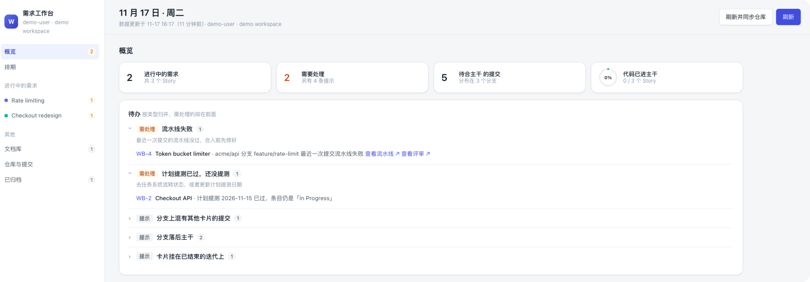
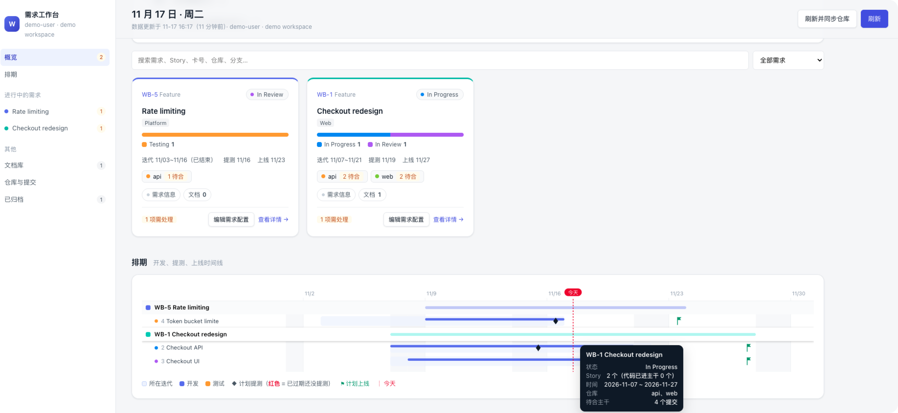
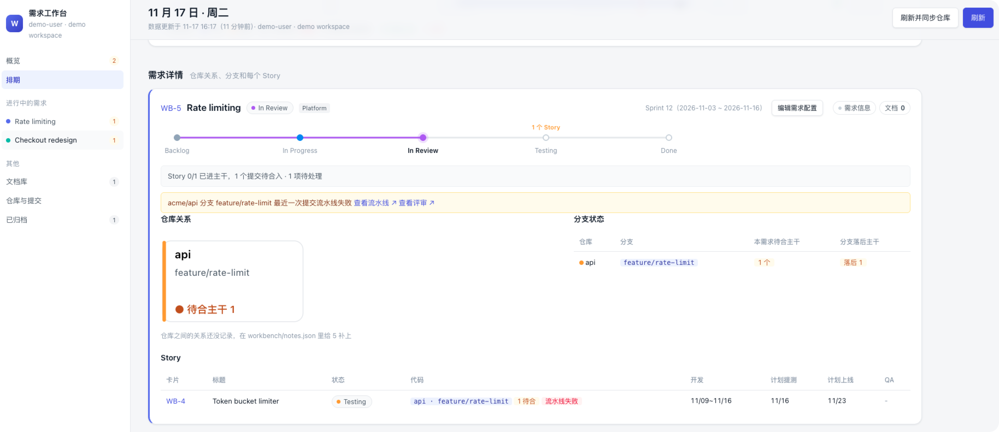
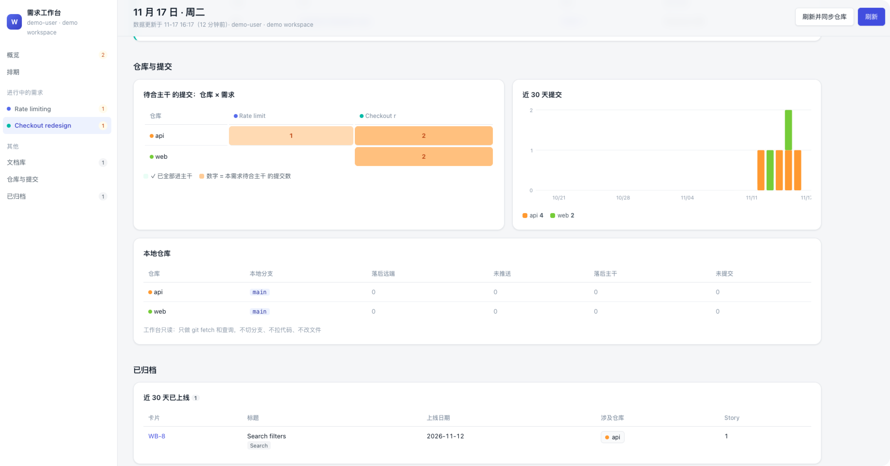

# workbench

[English](README.md) | 简体中文

一个本地看板,汇总分配给你的工作项和背后的代码。对每个需求,它会显示涉及哪些仓库和分支、提交是否已进入默认分支、评审和流水线状态、排期,以及一份需要你关注的待办清单。

- Python 3.9+,只用标准库。界面是纯 HTML、JavaScript 和 SVG,无需构建。
- 对你的仓库只读:只执行 `git fetch` 和查询,不会切换分支、拉取代码或修改文件。
- 任务跟踪系统以插件形式接入。内置 GitHub(issues、sub-issues、Projects v2、pull requests)。其他系统需要自己编写 provider,见 [Providers](#providers)。
- 界面目前是中文。英文语言包在计划中。

## 快速体验

```bash
python3 -m workbench serve --demo      # 在临时 git 仓库中生成虚构的工作项,无需账号
```

打开 http://127.0.0.1:8765/ 。









## 配合 GitHub 使用

```bash
python3 -m workbench init --provider github --workspace ~/code    # 写入 config.json 并运行检查
python3 -m workbench doctor                                        # 随时重新运行检查
./restart.sh                                                       # 在后台启动,监听 127.0.0.1:8765
```

认证方式:设置 `GITHUB_TOKEN`(或 `GH_TOKEN`),或用 `gh` CLI 登录(`gh auth login`)。若要从 Projects v2 看板读取阶段、日期和迭代,token 需要 `read:project` 权限(`gh auth refresh -s read:project`)。没有该权限时,阶段依次回退为名为 `status:<stage>` 的标签,再回退为 open/closed。

各概念的含义:

- 工作项是分配给你、处于 open 状态、且位于你本地仓库中的 issue。它的父级(sub-issue 的父 issue)就是需求。
- 引用该 issue 的 pull request 提供提交、评审和检查结果。
- `workspace` 是存放你本地克隆的目录。程序会递归查找(最多 3 层),读取每个克隆的 GitHub remote,只采集这些仓库里的 issue。不想再跟踪的项目,删除它的克隆或移出 workspace 即可。位于其他位置的克隆可以列在 `config.json` 的 `repo_paths` 里。把 `github.workspace_only` 设为 `false` 会改为采集分配给你的全部 issue,此时可以用 `github.search`(例如 `org:my-org -repo:my-org/finished`)缩小范围。
- 以这种方式找到的每个克隆,无论有没有 issue 关联,都会出现在「仓库与提交」里,显示本地状态和尚未合入默认分支的远端分支。需求仍然来自 issue。

全部选项见 `examples/config.github.json`。

## 数据存放位置

所有与你个人相关的内容都放在数据目录中,不会放在代码旁边。数据目录依次取 `$WORKBENCH_HOME`、`$XDG_CONFIG_HOME/workbench`、`~/.config/workbench`。

- `config.json`:provider、workspace、host 和 port、provider 选项。
- `notes.json`:按需求手工维护的内容,包括仓库关系(`nodes`、`edges`、`note`)、摘要(`info`)、文档链接(`docs`)、`track` 和归档。格式见 `examples/notes.example.json`。在界面中或手工编辑后点击刷新即可生效。
- `data.json`、`logs/`、`app.pid`:运行时文件。

服务监听 `127.0.0.1`,没有登录机制。如果绑定到其他地址,任何能访问该端口的人都能看到你的工作项。浏览器发起的跨域 POST 请求会被拒绝。

## 命令

```
python3 -m workbench serve [--demo] [--host H] [--port P]
python3 -m workbench collect [--no-fetch] [--demo]    # 采集一次,写入 data.json
python3 -m workbench init --provider NAME --workspace DIR [--set key.sub=value ...]
python3 -m workbench doctor
./restart.sh [port] | ./restart.sh stop
```

`pip install .` 会安装带有相同子命令的 `workbench` 命令。

## Providers

provider 把跟踪系统转换成普通的 dict,核心代码不会接触到特定系统的字段。接口约定写在 `workbench/providers/base.py`:`workflow()`、`whoami()`、`list_items()`、`get_parent()`、`dev_info()`,另有可选的 URL、提交信息中的 id 引用、迭代解析和 `doctor()`。

添加 provider 的方法:创建一个包含名为 `Provider` 的类的模块,并在配置中指向它:

```json
{"provider": "mytracker", "provider_module": "my_pkg", "plugin_paths": ["~/code/my-plugin"]}
```

插件也可以在 `workbench.providers` 组中注册 entry point。`workbench/providers/demo.py` 是最小的完整示例,`tests/test_github.py` 展示了如何用假客户端测试 provider。

## 开发

```bash
python3 -m unittest discover -s tests -t .
node tests/ui_smoke.js <data.json 的路径>      # 用模拟 DOM 渲染界面脚本
```

## 许可证

MIT
